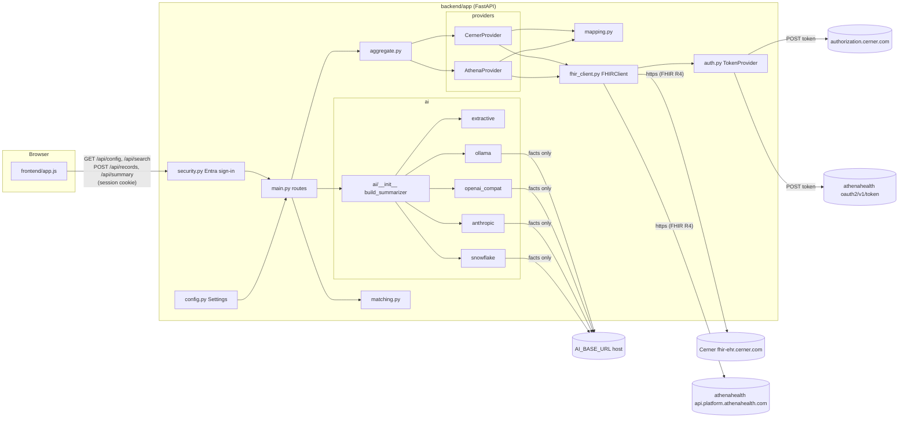
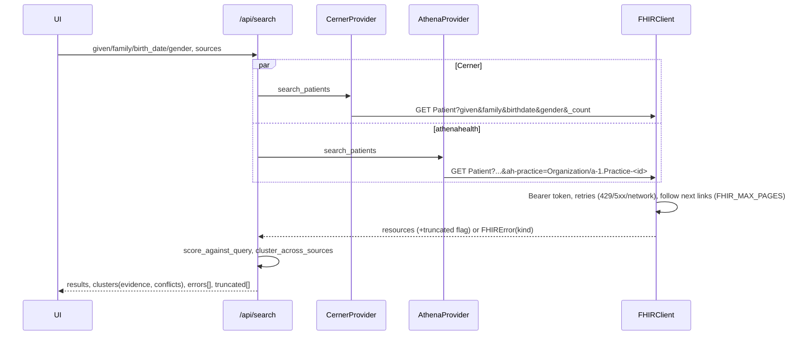

# Architecture

Diagrams are Mermaid (render on GitHub or any Mermaid viewer). Component and
endpoint names are the ones in the repository.

## Components



## Configuration to EHR authentication

```mermaid
sequenceDiagram
  participant S as Settings (.env)
  participant B as build_providers
  participant T as TokenProvider
  participant E as EHR token endpoint
  S->>B: EHRConfig per EHR + problems()
  alt problems
    B-->>S: provider not registered; /api/config lists missing variables
  else complete
    B->>T: FHIRClient(cfg)
  end
  Note over T: first FHIR call, or token within 60 s of expiry
  alt private_key_jwt
    T->>T: sign JWT (iss=sub=client_id, aud=token_url, exp=+300 s, kid, RS384)
    T->>E: POST grant_type=client_credentials, scope, client_assertion
  else client_secret_basic
    T->>E: POST grant_type=client_credentials, scope (Basic auth)
  end
  E-->>T: access_token, expires_in (cached) or error -> AuthError (sanitized)
```

## Patient retrieval (both EHRs)



Clinical data for a selected record (`/api/records`, `/api/summary`):
`Patient/{id}` read, then concurrently `Condition` (Cerner: one search per
category `problem-list-item` and `encounter-diagnosis`), `MedicationRequest`,
`AllergyIntolerance`, `Observation?category=vital-signs`, `Encounter`. A failed
resource type is listed in `fetch_errors`; a capped page walk in `truncated`.

## Matching, confirmation, summary

```mermaid
sequenceDiagram
  participant UI
  participant M as matching.py
  participant API as /api/summary
  participant AGG as aggregate.py
  participant AI as ai.summarize
  participant P as AI provider
  M-->>UI: clusters: candidate only if same birth date AND name similarity >= 0.8
  UI->>UI: user ticks records; selecting >1 opens the review panel (evidence, conflicts)
  UI->>API: selections, confirmed_same_person=true
  API->>AGG: fetch_records (per source, provenance kept)
  API->>AI: build_facts within AI_MAX_INPUT_CHARS -> omitted[]
  AI->>P: system prompt + <patient_records>facts</patient_records>
  P-->>AI: narrative or error (no fallback, no retry with another provider)
  API-->>UI: narrative, provider, data_destination, omitted, per_source records, disclaimer
```

## Sensitive-data boundaries

| Data | Leaves the host to | Controlled by |
|---|---|---|
| Search terms (names, DOB) | Cerner / athenahealth FHIR endpoints | `*_BASE_URL` |
| Client assertion / client secret | EHR token endpoints only | `*_TOKEN_URL` |
| Clinical facts (text rendered by `ai/base.py`) | the `AI_BASE_URL` host for ollama, openai_compat, anthropic, snowflake; nowhere for extractive | `AI_PROVIDER`, `AI_BASE_URL` |
| Logs | local rotating file only; no names, ids, query strings, tokens | `LOG_*` |
| Sign-in (authorization code + client secret) | login.microsoftonline.com; the browser gets an HttpOnly session cookie, no Entra token is stored | `SSO_*` |

The UI shows the active provider and destination host in the header and on every summary.
